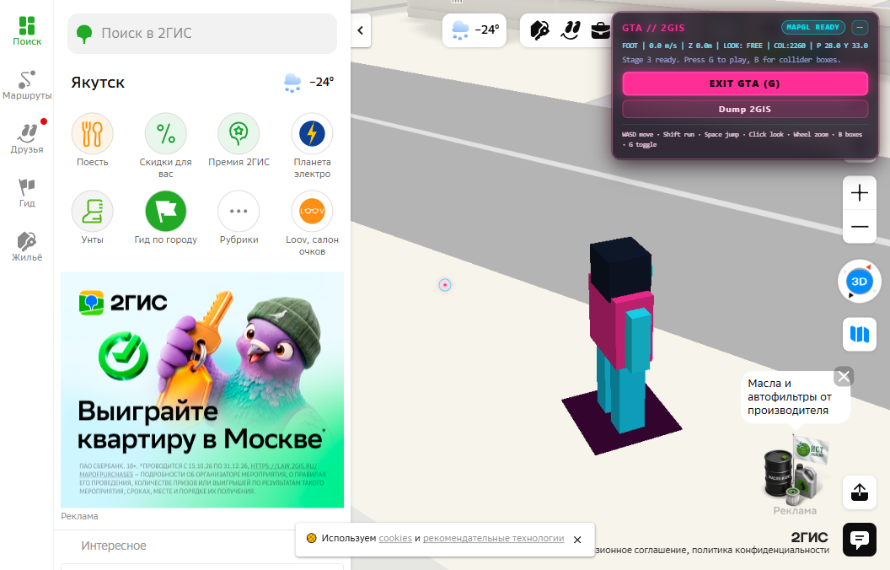

# GTA in 2GIS



Превращает обычный 3D-режим **2ГИС** в игру в духе GTA: от первого лица можно ходить по улицам, садиться в машину и ездить, с честными коллизиями зданий, крыш, заборов, деревьев, мостов и воды.

Это **Tampermonkey-юзерскрипт** — он подключается к уже открытой карте 2ГИС и добавляет поверх неё персонажа, машину, физику и HUD.

---

## Возможности

- 🚶 Ходьба и бег от первого лица (WASD, Shift — бег, Space — прыжок)
- 🚗 Машина: посадка/высадка, руль, газ/тормоз, дрифт
- 🧱 Коллизии: стены и крыши зданий, заборы, столбы, деревья, скамейки
- 🌉 Мосты и эстакады — можно ехать по ним на машине
- 🌊 Вода и плавание (в обычном режиме — плывёшь, в прототипе — выпрыгиваешь)
- ⚡ Режим «Прототип» (P): сверхскорость, высокий прыжок, бег по стенам
- 🏃 Отдельные анимации бега/прыжка/бега по стене/плавания
- 👁 Увеличенная дальность прорисовки зданий (600 м)
- 🎥 Камера-обскура при заходе за здание (персонаж подсвечивается силуэтом)

---

## Установка

### 1. Установите менеджер юзерскриптов

Один из:
- [Tampermonkey](https://www.tampermonkey.net/) (Chrome / Edge / Firefox)
- [Violentmonkey](https://violentmonkey.github.io/) (альтернатива)
- Greasemonkey (Firefox)

### 2. Установите скрипт

**Самый простой способ — установить готовый файл напрямую с GitHub:**

1. Откройте файл [`2gis-gta.user.js`](./2gis-gta.user.js) в репозитории.
2. Нажмите кнопку **Raw** (или откройте ссылку вида `https://raw.githubusercontent.com/<user>/<repo>/main/2gis-gta.user.js`).
3. Tampermonkey сам предложит установить скрипт — подтвердите.

**Либо вручную:**

1. Откройте панель Tampermonkey → **Create a new script**.
2. Удалите шаблон и вставьте всё содержимое файла `2gis-gta.user.js`.
3. Нажмите **Ctrl+S** (сохранить).

### 3. Запустите карту

1. Откройте [2gis.ru](https://2gis.ru) (или `2gis.kz`, `2gis.kg`, `2gis.uz`, `2gis.ae`).
2. Перейдите в **3D-режим** карты (кнопка слоёв / «3D»).
3. В правом верхнем углу появится панель **GTA // 2GIS**.
4. Нажмите **PLAY GTA** (или клавишу **G**).

---

## Управление

| Клавиша | Действие |
|---|---|
| **G** | Включить / выключить режим игры |
| **WASD / стрелки** | Движение |
| **Shift** | Бег |
| **Space** | Прыжок |
| **Мышь** | Обзор (клик — захват указателя) |
| **Колесо мыши** | Приблизить / отдалить камеру |
| **Q / E** | Поворот (без мыши) |
| **F** | Сесть в машину |
| **E** | Выйти из машины |
| **P** | Режим «Прототип» (суперскорость + высокий прыжок + бег по стенам) |
| **B** | Показать отладочные коллайдеры |

> В машине: **W/S** — газ/тормоз, **A/D** — руль, **Space** — ручник/дрифт.

---

## Сборка из исходников

Если хотите собрать скрипт самостоятельно (например, после правок):

```bash
node build.js
```

Скрипт склеивает модули из `src/` в один файл `2gis-gta.user.js` и проверяет синтаксис. Требуется только [Node.js](https://nodejs.org/) (никаких зависимостей ставить не нужно).

### Структура проекта

```
src/
  meta.js               # заголовок юзерскрипта (@name, @match, ...)
  probe.js              # поиск window.mapgl и отладочный дамп рантайма
  collision-extract.js  # извлечение коллайдеров из WebGL-тайлов 2ГИС
  collision.js          # физика коллизий (OBB, step-up, вода, дороги)
  camera-player.js      # контроллер игрока от первого лица
  player-gl.js          # 3D-персонаж (WebGL)
  vehicle.js            # физика машины
  vehicle-gl.js         # 3D-модель машины
  overlay.js            # 2D-силуэт и отладочные боксы
  hud.js                # панель управления
  main.js               # загрузка и игровой цикл
build.js                # сборка
```

---

## Решение проблем

- **Панель не появляется / статус «WAITING 2GIS…»** — откройте именно 3D-режим карты 2ГИС; скрипт ждёт `window.mapgl`, который создаётся только после загрузки карты.
- **Скрипт не срабатывает** — убедитесь, что домен совпадает с `@match` в заголовке (2gis.ru / 2gis.com / 2gis.kz / 2gis.kg / 2gis.uz / 2gis.ae).
- **Блокировщик рекламы** — некоторые блокировщики ломают загрузку 3D-бандла 2ГИС (`map3d.*.js`), из-за чего `window.mapgl` не создаётся. Добавьте 2gis в исключения.
- **Лаги** — дальность прорисовки и радиус коллизий можно уменьшить константами `VIEW_RADIUS_M` (в `src/camera-player.js`) и `radiusM` в `src/collision.js`.
- **Нет коллизий на конкретном здании** — нажмите **B**, чтобы увидеть отладочные боксы; коллизии строятся только из 3D-геометрии (здания, дороги, мосты), плоские подписи/маркеры не учитываются.

---

## Как это работает (кратко)

Скрипт находит глобальный объект `window.mapgl`, читает его внутренние WebGL-тайлы (`tileManager`), декодирует буферы вершин и строит набор OBB-коллайдеров (стены/крыши зданий, 3D-заборы, деревья, дороги, воду). Игровой цикл в `requestAnimationFrame` двигает персонажа/машину, разрешает коллизии (SAT + step-up) и синхронизирует камеру карты через `setCenter`/`setRotation`/`setPitch`. Подробности — в [`REPORT.md`](./REPORT.md).

---

## Лицензия

MIT — используйте свободно.
